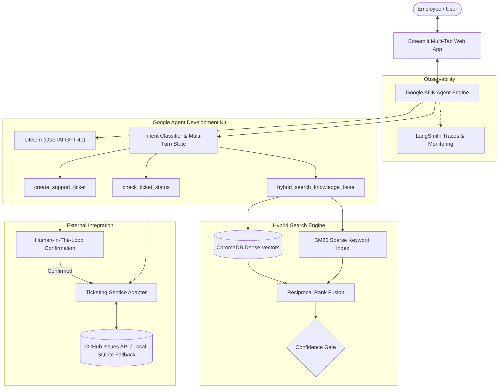

# SmartDesk AI — Intelligent IT & HR Operations Agent

**SmartDesk AI** is an enterprise conversational operations agent designed as a first-line support tier for employee IT and HR services. Built for *NovaTech Solutions* (a fictional 500-employee enterprise SaaS), SmartDesk AI resolves repetitive questions from a curated knowledge base, autonomously escalates unresolvable queries by opening support tickets, and enables employees to track ticket status in real-time.

---

## Key Features

1. **Hybrid Retrieval-Augmented Generation (Hybrid RAG)**:
   - Combines dense semantic vector search (**ChromaDB** with OpenAI `text-embedding-3-small`) and sparse lexical search (**BM25** with custom suffix stemming).
   - Merges results using **Reciprocal Rank Fusion (RRF)** ($k=60$) to balance conceptual meaning with exact keyword matching (e.g., product names, forms, policy numbers).
   - Strict source attribution citations with zero hallucination.

2. **Confidence Gating & Autonomous Escalation**:
   - Calculates a normalized confidence score $[0.0, 1.0]$.
   - Detects when queries fall below confidence thresholds or match engineered out-of-scope gaps (e.g., physical hardware defects, parking permits, production database access).
   - Automatically transitions to the **Ticket Creation Flow** instead of fabricating answers.

3. **Human-in-the-Loop (HITL) Ticket Creation**:
   - Gathers mandatory fields: Employee Email, Issue Title, Description, Category (`IT Support` or `HR Policies`), and Priority.
   - Presents an interactive preview summary for explicit employee approval before executing write operations.
   - Integrates with external ticketing systems (**GitHub Issues REST API**) with an automatic **SQLite local fallback** for offline environments.

4. **Real-Time Ticket Status Tracking**:
   - Queries tickets associated with the employee's email.
   - Handles single or multiple tickets with interactive selection, displaying current status (`Open`, `In Progress`, `Resolved`, `Closed`) and technician comments.

5. **Production-Ready Observability**:
   - Integrated with **LangSmith** for trace visualization, token consumption tracking, and latency monitoring.

---

## Architecture Overview



---

## Project Structure

```text
smartdesk-ai/
├── README.md                           # Project overview & quickstart guide
├── REQUIREMENTS.md                     # Product Requirements Document (PRD)
├── journey.md                          # Architectural log & decision records
├── requirements.txt                    # Project dependencies
├── .gitignore                          # Git ignore rules
├── scripts/
│   └── generate_kb.py                  # Generates domain Markdown docs from JSON
├── data/
│   └── knowledge_base/
│       ├── kb_entries.json             # Canonical master dataset (50 policies)
│       ├── deliberate_gaps.json        # 6 intentional escalation test scenarios
│       └── markdown/                   # 50 generated Markdown policy docs
│           ├── it_support/             # 15 IT policies
│           ├── hr_policies/            # 15 HR policies
│           ├── onboarding/             # 10 Onboarding guides
│           └── payroll_and_compensation/ # 10 Payroll & Comp policies
└── src/
    ├── __init__.py                     # Root package declaration
    └── rag/
        ├── __init__.py                 # RAG package exports
        ├── indexer.py                  # ChromaDB & BM25 indexing pipeline
        └── hybrid_retriever.py         # Dual search, RRF fusion & confidence gate
```

---

## Quickstart & Setup

### 1. Prerequisites
- Python 3.12+
- Git

### 2. Clone and Setup Environment
```bash
git clone https://github.com/Rohit-Saini-Sfdc/smartdesk-ai.git
cd smartdesk-ai

# Create virtual environment
python3.12 -m venv .venv
source .venv/bin/activate  # On Windows: .venv\Scripts\activate

# Install dependencies
pip install --upgrade pip
pip install -r requirements.txt
```

### 3. Configure Environment Variables (Optional)
Create a `.env` file in the root directory:
```bash
# OpenAI Configuration
OPENAI_API_KEY=your_openai_api_key_here

# LangSmith Observability (Optional)
LANGSMITH_TRACING=true
LANGSMITH_API_KEY=your_langsmith_key_here
LANGSMITH_PROJECT=smartdesk-ai

# GitHub Issues Ticketing (Optional - falls back to local SQLite if omitted)
GITHUB_TOKEN=your_github_personal_access_token
GITHUB_REPO_OWNER=your_github_username
GITHUB_REPO_NAME=your_repo_name
```
*(Note: SmartDesk AI operates with a deterministic local fallback if API keys are not provided, allowing zero-dependency offline verification).*

### 4. Build Indexes & Verify Retrieval
```bash
# Optional: Re-compile markdown files from canonical JSON source
python scripts/generate_kb.py

# Build ChromaDB vector store and BM25 index
python src/rag/indexer.py
```

### 5. Run Benchmark Tests
```bash
python -c "
from src.rag.hybrid_retriever import HybridRetriever
retriever = HybridRetriever()

# Test 1: In-KB Query
res = retriever.retrieve('How do I reset my password?')
print('Result 1:', res.suggested_action, '| Conf:', res.confidence, '| Doc:', res.chunks[0].title)

# Test 2: Out-of-Scope Gap (Triggers Escalation)
res_gap = retriever.retrieve('My laptop screen is flickering constantly.')
print('Result 2:', res_gap.suggested_action, '| Conf:', res_gap.confidence)
"
```

---

## License
MIT License.
