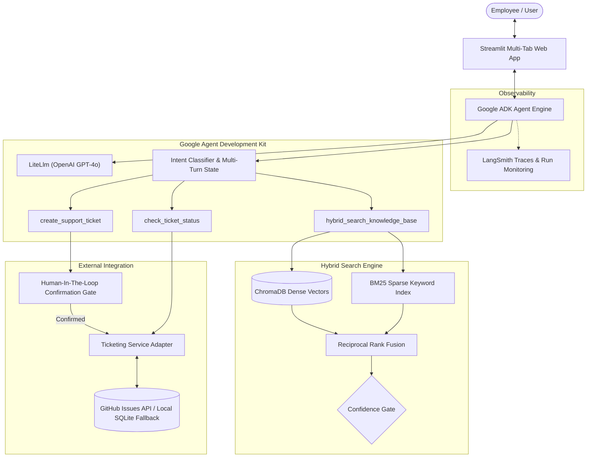

# Product Requirements Document (PRD) — SmartDesk AI

**System**: SmartDesk AI  
**Role**: Enterprise IT & HR Operations Conversational Agent  
**Target Organization**: NovaTech Solutions (500-Employee Enterprise SaaS)  
**Status**: In Active Development  

---

## 1. Executive Summary & Business Objective

In modern enterprises, IT and People Operations (HR) teams spend significant time answering repetitive employee inquiries: password resets, VPN troubleshooting, leave accruals, travel reimbursements, onboarding checklists, and payroll schedules. While policies are thoroughly documented, employees often struggle to find specific information across disparate wikis, leading to high support ticket volumes, delayed resolutions, and lost productivity.

**SmartDesk AI** is an intelligent, conversational operations agent placed as the first-line support tier between employees and corporate operations teams. It serves three core operational responsibilities:
1. **Immediate Resolution (RAG)**: Resolves factual and procedural queries instantly from a curated corporate knowledge base with grounded citations.
2. **Escalation & Ticket Creation (Write)**: Gracefully identifies questions outside its knowledge boundaries, collects necessary context, requires explicit employee confirmation, and creates a support ticket on an external platform.
3. **Ticket Status Tracking (Read)**: Allows employees to query the status and support comments of their existing tickets in real time.

---

## 2. High-Level System Architecture

---

## 3. Detailed Functional Requirements

### 3.1 Knowledge Base & Hybrid Retrieval (RAG)

#### 3.1.1 Knowledge Coverage
The knowledge base must provide authoritative policy documentation across four primary operational domains for NovaTech Solutions (minimum 50 structured policy articles):

| Domain | Key Policy Topics | Core User Queries Addressed |
| :--- | :--- | :--- |
| **IT Support** | Account access, GlobalProtect VPN, software catalog (JetBrains/Figma), Duo MFA setup, office & guest Wi-Fi, mobile email MDM, hardware refresh cycle (36 mo), security phishing incident response, Follow-Me badge printing, $750 WFH equipment stipends. | *"How do I reset my password?"* *"How do I connect to the VPN?"* *"How do I request a software licence?"* |
| **HR Policies** | Annual PTO (18 days/yr, 5-day carryover), sick leave (10 days, doctor note required for 3+ consecutive days), casual leave (6 days), parental leave (26 weeks maternity, 12 weeks paternity), hybrid WFH core hours (10 AM - 4 PM), Concur expense limits ($85/day meal cap), code of conduct, anti-harassment (POSH), performance reviews, $2,500 referral bonuses. | *"How many sick leaves per year?"* *"What is the WFH policy?"* *"How do I submit a reimbursement?"* |
| **Onboarding** | Day-1 schedule & badges, laptop shipment, Form I-9 verification (3-day deadline), buddy program, 14-day compliance training, 30-day benefits election window, direct deposit setup, 90-day probation review. | *"What do I do on my first day?"* *"When do I get my laptop?"* *"How do I enrol in insurance?"* |
| **Payroll & Comp** | Semi-monthly paydays (15th and month-end), W-2 / Form 16 access, 5% dollar-for-dollar 401(k) company match, annual bonus multipliers, 4-year RSU vesting with 1-year cliff, PagerDuty on-call compensation ($350/week + 1.5x comp off), $315 commuter transit benefits. | *"When is payday?"* *"How do I submit my tax declaration?"* *"How does vesting work?"* |

#### 3.1.2 Hybrid Retrieval Pipeline
- **Dense Vector Search**: Embeds chunks using OpenAI `text-embedding-3-small` and stores them in a local ChromaDB collection.
- **Sparse Keyword Search**: Inverted index built with BM25 (`rank-bm25`) with plural/inflection stemming for precise lookup of technical terms, acronyms, and policy names.
- **Reciprocal Rank Fusion (RRF)**: Merges ranked candidate lists using $k=60$ to prioritize documents validated by both semantic and lexical signals.
- **Source Attribution**: Answers must cite verified document IDs and titles (e.g., `[Source 1: IT-01 — Self-Service Password Reset]`). Zero hallucination is enforced.

#### 3.1.3 Confidence Handling & Escalation Gating
The system must calculate a normalized confidence score $[0.0, 1.0]$. If:
1. The confidence score is below the operational threshold ($< 0.40$), or
2. The query matches an engineered deliberate knowledge gap (e.g., broken laptop screens, office basement parking reservations, extended personal sabbaticals, production database credentials),

The agent must not invent an answer. It must acknowledge the information gap and automatically transition to the **Ticket Creation flow**.

---

### 3.2 Support Ticket Creation (Write Operation)

When a query cannot be resolved via documentation, or when an employee explicitly requests human assistance, the agent initiates ticket creation.

#### 3.2.1 Mandatory Context Gathering
Before creating a ticket, the agent must collect and validate:
- **Employee Email**: Unique identifier to associate the ticket with the employee. Must be remembered across session turns once provided.
- **Issue Summary**: Concise, descriptive title inferred from the conversation (e.g., *"Laptop Display Constantly Flickering"*).
- **Issue Description**: Detailed narrative synthesizing the conversation, user problem details, and troubleshooting attempted.
- **Category / Domain**: Automatically classified as `IT Support` or `HR Policies`.
- **Priority**: Inferred or explicitly stated (`Low`, `Medium`, `High`, `Critical`).

#### 3.2.2 Human-in-the-Loop (HITL) Confirmation Gate
- **Strict Safeguard**: Tickets must **never** be submitted silently or automatically without employee review.
- The agent must present a structured preview card showing Title, Category, Priority, and Description, and explicitly ask:
  > *"Here is the support ticket I will create for you: [Summary]. Shall I go ahead?"*
- Submission only executes after explicit employee approval.

#### 3.2.3 Post-Creation Confirmation
Upon successful creation, the agent must return:
- Unique Ticket Reference ID (e.g., `TICK-1024` or `#42`).
- Direct link to view/track the issue.
- Next steps regarding expected service-level response times (SLAs).

---

### 3.3 Ticket Status Tracking (Read Operation)

Employees must be able to check the status of existing requests at any time.

#### 3.3.1 Status Retrieval Flow
1. Employee asks: *"What is the status of my ticket?"* or *"Any updates on my laptop issue?"*.
2. The agent verifies the employee's email (using session memory or prompting if unknown).
3. The agent queries the ticketing adapter to retrieve all tickets linked to that email.
4. **Multiple Ticket Handling**: If the user has multiple tickets, the agent presents a list and allows the user to select which one to inspect.
5. **Detailed Status Presentation**: Displays current status (`Open`, `In Progress`, `Resolved`, `Closed`), assigned team, creation date, and recent support technician comments.
6. **Zero Ticket Handling**: If no tickets are found for that email, the agent politely informs the employee and offers to create a new ticket.

---

### 3.4 Multi-Turn Session & State Management

- **Context Retention**: The agent maintains active conversation memory within a session. The user's email, ongoing ticket draft, and current topic are retained without repeatedly re-asking the user.
- **Polite & Professional Tone**: Empathetic, clear, and professional tone suited for corporate enterprise communication.
- **Small Talk & Out-of-Scope Handling**: Gracefully handles greetings, farewells, and general chit-chat while remaining focused on IT and HR operations.

---

## 4. Technical Stack & Infrastructure Requirements

| Component | Technology | Role & Functionality |
| :--- | :--- | :--- |
| **Agent Framework** | **Google ADK (`google-adk`)** | Orchestrates tool calling, multi-turn conversation loops, and structured state management. |
| **Foundation LLM** | **OpenAI GPT-4o** via **LiteLLM** | High-performance reasoning engine connected through Google ADK's `LiteLlm` interface. |
| **Dense Embeddings** | **OpenAI `text-embedding-3-small`** | 1536-dimensional semantic vector embeddings. |
| **Vector Database** | **ChromaDB** | Local persistent vector store storing chunk embeddings and metadata. |
| **Sparse Index** | **BM25 (`rank-bm25`)** | Lexical keyword index with custom suffix stemming. |
| **Ticketing Adapter** | **GitHub Issues REST API** + **SQLite** | Primary external REST API integration with automated local SQLite fallback for offline operations. |
| **Web Interface** | **Streamlit** | Multi-tab UI featuring interactive chat, live ticket tracker, and knowledge base explorer. |
| **Observability** | **LangSmith** | End-to-end trace logging, latency tracking, and execution monitoring. |

---

## 5. Non-Functional & Reliability Requirements

1. **Security & Secrets Management**:
   - Zero hardcoded API keys or credentials in source code.
   - All secrets managed via environment variables and `.env` files.
2. **Offline & Graceful Fallback**:
   - If external APIs (GitHub or OpenAI) are unreachable or unconfigured, the system fails over gracefully:
     - Ticketing seamlessly uses the local SQLite engine.
     - Embeddings fall back to deterministic local indexing.
3. **Response Latency**:
   - Local RAG retrieval should return in $< 50$ ms.
   - End-to-end streaming conversational responses in $< 2$ seconds.
4. **Code Quality & Testing**:
   - Modular, object-oriented Python architecture with strict type hints.
   - Comprehensive test suite covering intent classification, retrieval accuracy, and ticketing operations.

---

## 6. Target User Experience & UI Tabs

The Streamlit web application will provide three specialized tabs:
- **Tab 1: SmartDesk AI Assistant**: Real-time conversational interface with streaming responses, formatted citation badges, and interactive HITL ticket confirmation cards.
- **Tab 2: Ticket Management Dashboard**: Live table of all tickets, filterable by status (`Open`, `In Progress`, `Closed`), priority, and email, showing comments and resolution status.
- **Tab 3: Knowledge Base & Observability Explorer**: Searchable directory of all 50 indexed policies, similarity score visualizer, and LangSmith trace status indicators.
